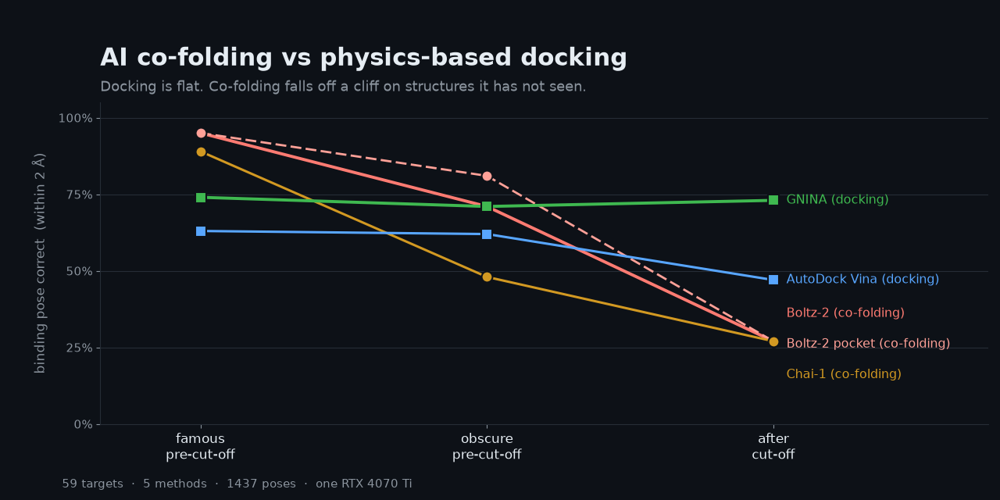

# Co-folding vs physics-based docking



**Can AI co-folding models replace physics-based docking, and where do they fail?**

This project benchmarks AI structure-prediction models that fold a protein
*together with* its ligand (**Boltz-2** blind and pocket-conditioned,
**Chai-1**) against physics-based docking (**GNINA**, **AutoDock Vina**) on the
same targets, and asks three questions of every pose:

1. **Is it in the right place?** Pocket-aligned, symmetry-aware ligand RMSD
   (success = within 2 Å of the crystal pose).
2. **Does it make the right contacts?** Recovery of the crystal structure's
   protein-ligand interactions (hydrophobic, polar, ionic), per residue.
3. **Is it physically plausible?** Protein-ligand clashes and an intact ligand
   (co-folding models sometimes produce broken or overlapping molecules).

The docking half reuses my existing workflows:
[gnina-ensemble-docking](https://github.com/hankurt/gnina-ensemble-docking),
[autodockGPU-vina-docking](https://github.com/hankurt/autodockGPU-vina-docking),
and the interaction analysis connects to
[plip-interaction-fingerprints](https://github.com/hankurt/plip-interaction-fingerprints).

> **Status:** 59 targets, 5 methods, 1437 poses on one RTX 4070 Ti.
> **[Results and analysis →](docs/RESULTS.md)**
>
> **Headline:** "released before the training cut-off" turns out to be two
> conditions, not one, and separating them is the result:
>
> | Top-1 success | famous, pre-cut-off | obscure, pre-cut-off | after cut-off |
> |---|---|---|---|
> | Boltz-2 | 95% | 71% | 27% |
> | Chai-1 | 89% | 48% | 27% |
> | GNINA | 74% | 71% | 73% |
> | Vina | 63% | 62% | 47% |
>
> Docking is flat across all three; co-folding falls monotonically. Mere
> presence in the training set is not what drives co-folding's accuracy —
> obscure structures from the same years cost Boltz-2 24 points. On those
> ordinary seen structures Boltz-2 and GNINA are indistinguishable (71% each,
> paired p = 1.0); on unseen ones GNINA wins (p = 0.039). Aggregated over all
> 55 scored targets GNINA and Boltz-2 are statistically inseparable (p = 0.65),
> so the overall average hides the whole effect.
>
> Caveat first: this is re-docking into the **crystal receptor**, which favours
> docking; see [Limitations](docs/RESULTS.md#limitations).

---

## Pipeline

```
data/candidates.csv ─┐
cofoldbench search ──┴─cofoldbench fetch──▶ data/targets.csv + data/structures/
                                               │
data/targets.csv ──cofoldbench inputs──▶ Boltz-2 YAML · Chai-1 FASTA
        │                                        │ (GPU)
        │                                        ▼
        │                                 runs/boltz2 · runs/chai1
        │                                        │
        ├─cofoldbench dockprep─▶ receptor · ligand · box
        │        scripts/run_docking.sh ─────────┤  GNINA / Vina
        │                            cofoldbench collect  ──▶ results/manifest.csv
        │                                        │
        └────────────────────────────▶ cofoldbench evaluate ──▶ results/results.csv
                                                 │                results/aligned/*.pdb
                                                 ▼
                                       cofoldbench report ──▶ summary table + figures
```

### Fair-comparison design

| Issue | How it is handled |
|---|---|
| Co-folding models output their own frame and number residues from 1 | Every pose is mapped to the reference numbering by **sequence alignment** and superposed on the **pocket Cα atoms** (≤ 10 Å of the crystal ligand) before any ligand comparison |
| Different engines name and order ligand atoms differently, and some lose bond orders | RMSD is computed on the **heavy-atom graph**, minimised over all symmetry-equivalent atom mappings |
| Docking is told where the pocket is; blind co-folding is not | Boltz-2 is run twice: **blind** and **pocket-conditioned** (pocket constraint on the same residues used to box the docking) |
| Each method's top pose vs its best pose | Both are reported: **top-1** (what the method would pick) and **best-of-5** (what it can sample) |
| A method that produces nothing for a target would otherwise be scored only on the targets it managed | Every method is scored over the **same target set**; a target with no pose counts as a failure and is reported as `n_missing` (Boltz-2 silently skips targets that exhaust GPU memory) |
| A broken or clashing ligand can still score a low RMSD | Separate **physically-valid success** rate: RMSD ≤ 2 Å *and* intact ligand *and* no clashes |
| Co-folding models may have memorised famous complexes | **Time split**: the report gives every metric separately for targets released before and after the training cut-off (Boltz-2: 2023-06-01) |
| Docking could start from the answer | The docking ligand is a conformer generated **from the SMILES**, never the crystal pose; the box comes from the same pocket residues as the Boltz-2 pocket constraint |
| The ligand definition must match the crystal | `fetch` checks that the CCD SMILES and the crystal ligand have the **same heavy-atom graph** and rejects targets with unmodelled ligand atoms |

---

## Install

```bash
conda create -n cofoldbench python=3.11 -y   # conda only provides Python
conda activate cofoldbench
pip install -e ".[test,dock]"                # all dependencies are pip wheels
pytest                                       # tests on the 6DPT example
```

**Step-by-step on a GPU workstation without sudo: [docs/RUNBOOK.md](docs/RUNBOOK.md).**

(`conda env create -f environment.yml` does the same in one step. Avoid
installing the dependencies with conda itself: in a busy conda setup the
solver can take a very long time.)

The prediction tools each go in their own environment:
`pip install boltz` (Boltz-2) and `pip install chai_lab` (Chai-1). Both need a
CUDA GPU. GNINA and AutoDock Vina are single binaries:
`scripts/install_docking_tools.sh` puts them in `~/.local/bin`.

**GPU troubleshooting** (all seen on a 12 GB RTX 4070 Ti, driver 535 / CUDA 12.2):

| Error | Fix |
|---|---|
| `NVIDIA driver on your system is too old` | pip installed a PyTorch built for a newer CUDA. In the model env run `scripts/fix_torch_cuda.sh`: it reinstalls the same torch version from a CUDA 12.6 / 12.4 / 12.1 build and checks that CUDA works. Or update the driver (550+). |
| `No module named 'cuequivariance_torch'` | Run Boltz with `--no_kernels` (the default in `scripts/run_boltz.sh`), or install `cuequivariance-torch cuequivariance-ops-torch-cu12`. |
| `CUDA out of memory` / `cusolver ... INTERNAL_ERROR` | Compute samples one at a time: `--max_parallel_samples 1` (default in the script), plus `PYTORCH_CUDA_ALLOC_CONF=expandable_segments:True`. |

---

## Usage

### 1. Define targets: `data/targets.csv`

| Column | Meaning |
|---|---|
| `target_id` | name used in all file names and tables |
| `structure` | reference holo structure (relative to the CSV) |
| `chain` | receptor chain(s) |
| `ligand_resname` | ligand residue name in the reference |
| `smiles` | ligand SMILES given to the co-folding models |
| `pocket_residues` | binding-site residues (reference numbering); the same list boxes the docking |
| `sequence` | optional full construct; default = modelled residues of the reference (the tool warns if there are gaps) |
| `release_date` | optional PDB release date; splits the report before / after the training cut-off |
| `resolution`, `note` | optional, informational |

The table is normally built by `fetch` rather than by hand:

```bash
cofoldbench fetch data/candidates.csv          # classic drug complexes (PDB ID + ligand code)
cofoldbench fetch data/candidates_recent.csv   # curated time-split set (after the cut-offs)
cofoldbench search --after 2023-06-01 --n 45   # or search your own -> data/candidates_search.csv
cofoldbench search --after 2015-01-01 --before 2021-01-01 --n 15   # a pre-cut-off control set
```

`fetch` downloads each entry, keeps the receptor chain(s) and one ligand
copy, takes the SMILES from the Chemical Component Dictionary, checks it
against the crystal ligand, sets the pocket (residues ≤ 4.5 Å from the
ligand) and the full SEQRES construct, and records release date and
resolution. It warns about cofactors next to the ligand (absent from the
co-folding inputs), **covalent ligands** (no non-covalent method can
reproduce them), **sites that span a crystallographic symmetry mate** (only
half the pocket is present, so every method fails) and proteins too large for
a 12 GB GPU. `search` keeps
entries with one protein and exactly one drug-like ligand (250-700 Da, no
cofactors), one per protein. A recent release date is necessary but not
sufficient for novelty: a close homologue with a similar ligand can still be
in the training set, so review the hits.

### 2. Write co-folding inputs

```bash
cofoldbench inputs                # -> inputs/boltz/{blind,pocket}/  inputs/chai/
```

### 3. Predict (GPU)

```bash
scripts/run_boltz.sh blind        # Boltz-2, 5 samples, then collects into the manifest
scripts/run_boltz.sh pocket       # Boltz-2 with the pocket constraint
scripts/run_chai.sh               # Chai-1
```

### 4. Dock, then collect

```bash
cofoldbench dockprep              # -> inputs/dock/<target>/ receptor.pdb, ligand.sdf, box.txt (+ PDBQT)
scripts/run_docking.sh            # GNINA + Vina for every target, then collects
```

Poses from the existing workflows are collected the same way:

```bash
cofoldbench collect gnina    --target 6DPT --receptor receptor.pdb --poses docked.sdf
cofoldbench collect vina     --target 6DPT --receptor receptor.pdb --poses out.pdbqt
cofoldbench collect single   --target 6DPT --structure pose.pdb --method my_method
```

Collecting again for the same target and method replaces the old rows, so
re-runs are safe.

### 5. Evaluate and report

```bash
cofoldbench evaluate              # -> results/results.csv, results/aligned/<target>/<method>_rank<k>.pdb
cofoldbench report                # -> results/report/summary.{csv,md} + figures
cofoldbench stats                 # confidence intervals + paired tests on the same numbers
```

`results/aligned/` holds every pose **in the reference frame and numbering**,
ready for full PLIP profiling with
[plip-interaction-fingerprints](https://github.com/hankurt/plip-interaction-fingerprints)
(set `PDB_PATTERN='*.pdb'` in `process_plip.sh`).

---

## Metrics

| Column in `results.csv` | Meaning |
|---|---|
| `ligand_rmsd` | symmetry-aware heavy-atom RMSD after pocket superposition (Å) |
| `centroid_dist` | ligand centre-of-mass displacement (Å) |
| `pocket_ca_rmsd` | pocket Cα RMSD after fitting: how well the receptor pocket itself was predicted |
| `min_dist`, `n_clashes` | closest protein-ligand heavy-atom distance; pairs < 2.2 Å |
| `graph_ok` | the pose's ligand has the same heavy-atom graph as the crystal ligand |
| `recovery_all` / `_hydrophobic` / `_polar` / `_ionic` | fraction of crystal interactions reproduced |
| `fp_tanimoto` | Tanimoto similarity of pose and crystal interaction fingerprints |

`--split exposure` splits the pre-cut-off half into famous and obscure
targets; `stats` puts error bars on all of it: a Wilson interval on every success rate,
an exact McNemar test for each pair of methods on the same targets (a few
dozen targets make unpaired comparisons much weaker than paired ones), and a
Newcombe interval on each method's before/after cut-off difference.

The built-in fingerprint is geometric (distance cut-offs, no angles) so it
runs without extra dependencies; PLIP on the aligned complexes gives the full
profile.

`report` summarises per method: top-1 success, physically-valid top-1
success, best-of-5 success, median top-1 RMSD, mean interaction recovery and
pocket Cα RMSD. When `targets.csv` has release dates, every method also gets
a *before cutoff* and an *after cutoff* row (`--cutoff`, default the Boltz-2
cut-off 2023-06-01; Chai-1 2021-01-12). `--exclude` leaves
targets out of the comparison, e.g. ones a model could not run at all on the
available GPU, so a hardware limit is not read as a modelling failure. Figures: success rates, RMSD cumulative distribution, and
RMSD vs interaction recovery.

---

## Project layout

```
cofoldbench/
  search.py      find recent PDB complexes (time-split candidates)
  fetch.py       download, clean and validate targets -> targets.csv
  structure.py   read PDB / mmCIF / SDF / PDBQT into one representation
  superpose.py   sequence mapping + pocket superposition
  ligand.py      symmetry-aware RMSD, clash and ligand-integrity checks
  contacts.py    residue interaction fingerprints, recovery
  inputs.py      Boltz-2 / Chai-1 input writers
  dockprep.py    receptor / ligand / box (+ PDBQT) for GNINA and Vina
  collect.py     per-engine output readers -> manifest
  evaluate.py    score every pose
  report.py      summary table and figures
  stats.py       Wilson intervals, exact McNemar, before/after cut-off difference
  cli.py         `cofoldbench` command
data/            targets, candidates, reference structures
scripts/         run scripts (Boltz-2, Chai-1, docking), tool installer, environment check
docs/RUNBOOK.md  step-by-step run on a GPU workstation
tests/           end-to-end tests on 6DPT
```

---

## Roadmap

### Done

- [x] Evaluation pipeline: pocket-aligned symmetric RMSD, interaction recovery, validity checks
- [x] Input writers for Boltz-2 and Chai-1; collectors for every engine run here
- [x] Tests on AmpC / H7M (6DPT)
- [x] Target building from PDB IDs with ligand checks; time-split search; before/after cut-off report
- [x] Docking inputs (SMILES conformer, shared pocket box) and GNINA / Vina run script
- [x] Target set: 22 classic + 21 obscure pre-cut-off + 16 post-cut-off complexes
- [x] Run Boltz-2 (blind + pocket), Chai-1, GNINA and Vina ([runbook](docs/RUNBOOK.md))
- [x] Statistics: Wilson intervals, paired McNemar tests, before/after cut-off differences
- [x] Control: obscure pre-cut-off targets, separating "heavily represented" from merely "seen"
- [x] **[Write-up of the results](docs/RESULTS.md)**

### Next

- [ ] **Second docking seed**, to quantify run-to-run noise (`SEED=2 METHOD_SUFFIX=_s2`)
- [ ] Rebuild 9XHG (STING) with both chains of the dimer, or drop it
- [ ] Full PLIP profiles on the aligned poses

### Further out

- [ ] **Cross-docking**: receptors from apo or MD ensembles (from the metadynamics workflow), where docking suffers most — the main limitation of this run
- [ ] Metalloenzymes and cofactor sites: pass metals and cofactors to the co-folding inputs and keep them in the docking receptor (currently excluded, which rules out e.g. carbonic anhydrases)
- [ ] Boltz-2 predicted affinity vs docking scores vs experimental affinities (affinities already collected)

---

## License

MIT - see [LICENSE](LICENSE).
# cofolding-vs-physics-docking
